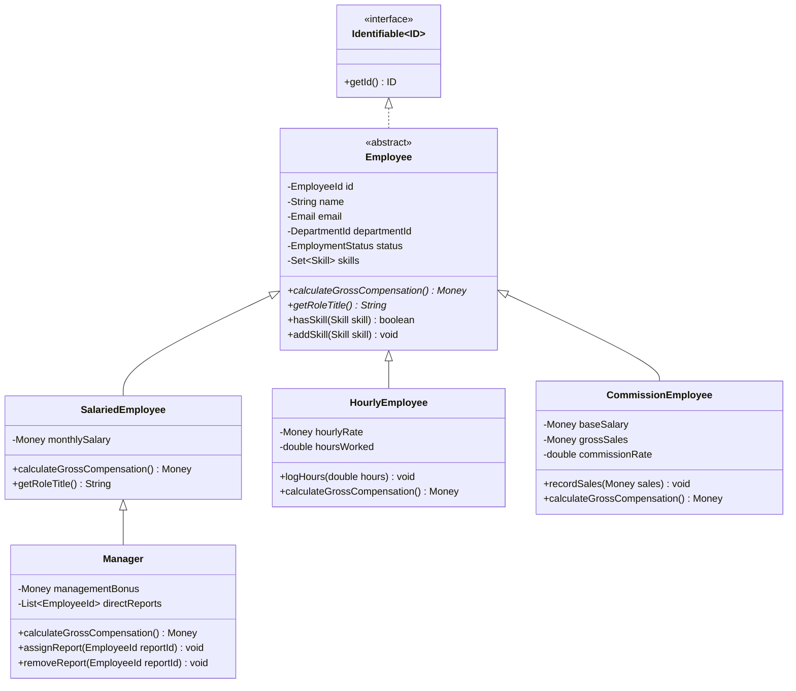
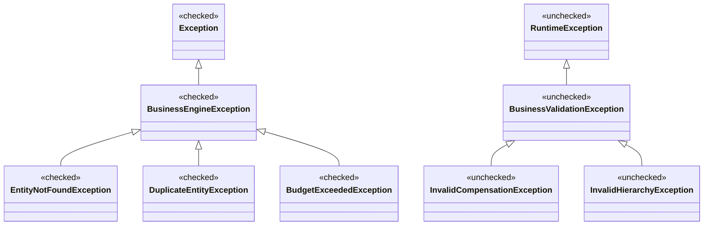

# Implementation Plan - Core Java OOP, Collections Framework & Exception Hierarchy (Module 03)

Build a robust, production-quality **Core Java Business Management Engine** that demonstrates advanced Object-Oriented Programming (OOP) concepts, polymorphic inheritance hierarchies, abstract classes, Java 17 records, generic Collections (`List`, `Set`, `Map`), functional Java Streams & Lambdas, and a two-tier custom exception hierarchy (checked vs. unchecked).

## User Review Required

> [!IMPORTANT]
> - **Java Version**: Java 17 (`17.0.12`).
> - **Project Location**: `C:\Users\sudhe\.gemini\antigravity\scratch\business-management-engine`.
> - **Tooling**: Built using Maven (`pom.xml`) with standalone JUnit Jupiter 5.10.2 and AssertJ 3.25.3. Zero heavy frameworks (Spring, Hibernate, etc.) to keep it pure core Java.
> - **Public Deliverable**: We will initialize a local Git repository, run all unit tests to ensure 100% pass, and provide step-by-step instructions for pushing to a public GitHub repo to submit on the academy portal.

---

## Architectural & Domain Design



### 1. OOP Principles & Domain Models
- **Encapsulation**: Private fields, immutable value objects via Java 17 records (`EmployeeId`, `DepartmentId`, `Money`, `Email`, `PayrollReport`), defensive copying of collections (`Collections.unmodifiableList`, `Collections.unmodifiableSet`).
- **Polymorphism & Abstraction**:
  - Abstract base class: `Employee` defining template contracts and common personnel attributes.
  - Subclasses:
    - `SalariedEmployee`: Fixed regular compensation.
    - `Manager`: Extends `SalariedEmployee`, manages team list (`List<EmployeeId>`), adds management leadership bonuses.
    - `HourlyEmployee`: Hourly rate with overtime calculation (1.5x for hours $> 40$).
    - `CommissionEmployee`: Base salary plus calculated commission from gross sales.
  - Entity: `Department` managing a unique `Set<EmployeeId>`, budget allocations, and department metadata.

### 2. Generic Collections & Functional Streams Engine
- **`List`**: Maintains ordered audit events, direct reports hierarchy, and historical pay run records.
- **`Set`**: Guarantees uniqueness for employee skills (`Set<Skill>`) and department memberships (`Set<EmployeeId>`), preventing duplicate assignments.
- **`Map`**:
  - In-memory generic store backing: `Map<ID, T>` for fast $O(1)$ lookups.
  - Analytics and grouping:
    - Grouping employees by department (`Map<DepartmentId, List<Employee>>`).
    - Multi-criteria indexing (`Map<Skill, Set<Employee>>`).
- **Streams & Lambdas (`EmployeeAnalyticsEngine`)**:
  - Filtering: Multi-predicate filtering (by status, salary threshold, minimum experience, department).
  - Sorting: Flexible sorting using chained comparators (`Comparator.comparing(...).thenComparing(...)`).
  - Aggregations: Total payroll expenditure, average compensation per department, highest paid performers using `Collectors.groupingBy`, `Collectors.summarizingDouble`, `Collectors.partitioningBy`, and `Collectors.flatMapping`.

### 3. Custom Exception Hierarchy (Checked vs. Unchecked)



- **Checked Exceptions (`BusinessEngineException extends Exception`)**:
  - For recoverable or expected business workflow conditions:
    - `EntityNotFoundException`: Thrown when querying an employee or department that does not exist.
    - `DuplicateEntityException`: Thrown when attempting to register an employee with an already registered ID or Email.
    - `BudgetExceededException`: Thrown when a department's total payroll exceeds its allocated financial budget.
- **Unchecked Exceptions (`BusinessValidationException extends RuntimeException`)**:
  - For program logic violations and invariant enforcement:
    - `InvalidCompensationException`: Thrown on negative salary, negative hours worked, or commission rates outside $[0.0, 1.0]$.
    - `InvalidHierarchyException`: Thrown on circular managerial reporting or attempting to assign an employee as their own manager.

---

## Proposed Changes

### Directory Structure: `C:\Users\sudhe\.gemini\antigravity\scratch\business-management-engine`

#### [NEW] [pom.xml](file:///C:/Users/sudhe/.gemini/antigravity/scratch/business-management-engine/pom.xml)
- Configured for Java 17 compiler release, Maven Surefire plugin, JUnit Jupiter 5.10.2, AssertJ 3.25.3.

#### [NEW] Core Common & Value Objects (`com.rabtech.engine.common`)
- `Identifiable.java`: Generic interface defining `ID getId()`.
- `Money.java`: Immutable Java 17 record with `BigDecimal` arithmetic, addition, multiplication, formatting, and non-negative constraints.
- `Email.java`: Record value object with regex email validation.

#### [NEW] Domain Model (`com.rabtech.engine.domain.model`)
- `EmployeeId.java`, `DepartmentId.java`: Strongly typed record IDs.
- `Skill.java`: Enum representing technical and domain skills.
- `EmploymentStatus.java`: Enum (`ACTIVE`, `ON_LEAVE`, `TERMINATED`).
- `Department.java`: Encapsulated entity managing `DepartmentId`, name, `Money budget`, and `Set<EmployeeId> members`.
- `Employee.java`: Abstract base entity encapsulating employee identity, status, department, and skills.
- `SalariedEmployee.java`: Concrete class for salaried staff.
- `HourlyEmployee.java`: Concrete class with hourly tracking and overtime rules.
- `CommissionEmployee.java`: Concrete class with base pay and commission computation.
- `Manager.java`: Subclass of `SalariedEmployee` with team management (`List<EmployeeId>`) and managerial bonus.
- `PayrollReport.java`: Record representing processed payroll summaries.

#### [NEW] Custom Exception Hierarchy (`com.rabtech.engine.exception`)
- `BusinessEngineException.java` (Checked base)
- `EntityNotFoundException.java` (Checked)
- `DuplicateEntityException.java` (Checked)
- `BudgetExceededException.java` (Checked)
- `BusinessValidationException.java` (Unchecked base)
- `InvalidCompensationException.java` (Unchecked)
- `InvalidHierarchyException.java` (Unchecked)

#### [NEW] Generic Repository Layer (`com.rabtech.engine.repository`)
- `GenericRepository.java`: Generic CRUD interface (`save`, `findById`, `findAll`, `deleteById`, `existsById`).
- `InMemoryRepository.java`: Generic thread-safe `Map<ID, T>` implementation.
- `EmployeeRepository.java`: Specialized interface with query methods by department, email, status.
- `DepartmentRepository.java`: Specialized interface for departments.

#### [NEW] Business Engines & Services (`com.rabtech.engine.service`)
- `BusinessManagementEngine.java`: Main facade coordinating employee onboarding, department transfers, managerial assignments, and budget validation.
- `EmployeeAnalyticsEngine.java`: Advanced Stream API queries (grouping by department, filtering by salary/skill, multi-criteria sorting with custom Comparators, partitioning active vs inactive).
- `PayrollService.java`: Evaluates payroll calculations across polymorphic employee types and validates department budgets.

#### [NEW] JUnit 5 Test Suites (`src/test/java/com/rabtech/engine`)
- `domain/EmployeeHierarchyTest.java`: Tests inheritance, polymorphism, overtime calculation, commission calculation, and manager bonuses.
- `domain/DepartmentTest.java`: Tests `Set` uniqueness, membership controls, and encapsulation.
- `exception/ExceptionHierarchyTest.java`: Tests checked vs. unchecked exception handling, propagation, and message contents.
- `repository/GenericRepositoryTest.java`: Tests generic collection operations (`List`, `Map`), lookups, and constraints.
- `service/EmployeeAnalyticsEngineTest.java`: Tests Streams and Lambdas: sorting, filtering, `Collectors.groupingBy`, `Collectors.summarizingDouble`, `Collectors.partitioningBy`.
- `service/BusinessManagementEngineTest.java`: End-to-end business workflows, checked exception recoveries, and budget checks.

#### [NEW] Documentation & Git Repository
- `README.md`: Detailed documentation explaining OOP inheritance, generic collections, Streams/Lambdas, exception hierarchies, architecture diagrams, and submission instructions.
- Git repository initialization with initial commits.

---

## Verification Plan

### Automated Tests
Run the entire JUnit 5 test suite using Maven:
```powershell
& "C:\Users\sudhe\.gemini\antigravity\scratch\tools\apache-maven-3.9.6\bin\mvn.cmd" clean test -f "C:\Users\sudhe\.gemini\antigravity\scratch\business-management-engine\pom.xml"
```
Verify:
1. 100% passing tests across all domain models, repositories, analytics streams, and exception tests.
2. Verified enforcement of custom checked and unchecked exceptions.
3. Verified generic collection invariants (no duplicate set entries, map lookups, list ordering).

### Git Repository & Submission Readiness
- Verify `git status` and `git log` show clean, properly structured commits.
- Confirm ready for pushing to GitHub for instant submission.
